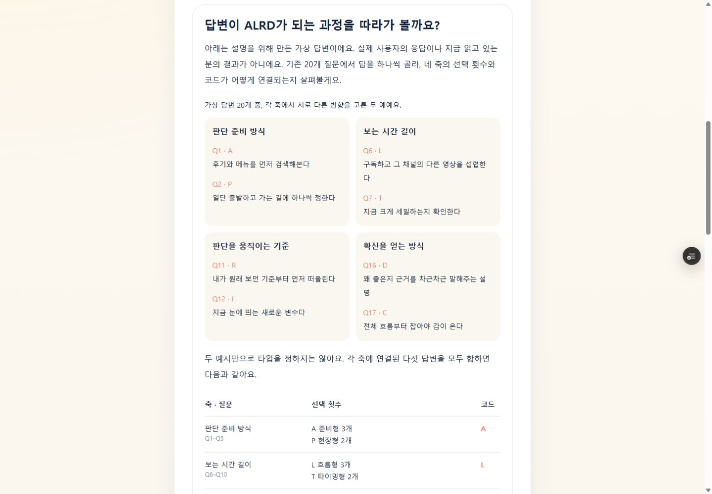
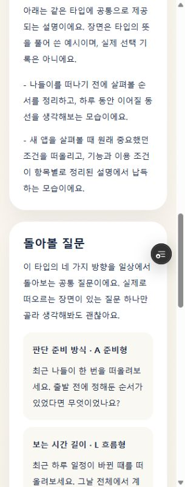

# C1–C3 구현 및 Preview 검증 기록

> 최신 상태: 이 기록 이후 사용자가 200% 확대 미확인 고지를 받은 상태에서 “운영 반영해줘”라고 승인했다. 2026-10-12 동일 제품 커밋 `572c8e6`을 운영에 반영하고 확인했다. [운영 반영 기록](2026-10-12-content-production-verification.md)을 현재 상태로 본다. 아래는 Preview 단계의 사실과 판단 이력이며 확대 미확인은 그대로 유지한다.

확인일: 2026-10-12 KST. 사용자가 [수정 승인안](2026-10-12-content-improvement-approval-plan.md)에 “응 진행해”라고 회신한 뒤 구현했다. **제품 구현과 로컬·Preview의 핵심 검증은 완료했다. 200% 브라우저 확대는 미확인이므로 전체 수동 검증 완료로 표현하지 않는다.** 운영 배포·광고 설정·AdSense 재신청은 실행하지 않았다.

## 구현 위치와 배포 근거

- 실제 프로젝트: `C:\Users\D-\Documents\Codex_Project\GaemigulTest`
- 작업 트리: `.worktrees/approved-experience`, 브랜치 `codex/approved-experience`
- 시작 기준: `4321fe93ea35a0ffc31a839a310f2f8fd5c8aa38`
- 제품 커밋: `572c8e6e661ba5ecf60535dbcb67e30d490a7a70`
- [Preview](https://gaemitype-git-codex-approved-experience-joyshu93s-projects.vercel.app/guides/reading-results)
- [Vercel 배포 상세](https://vercel.com/joyshu93s-projects/gaemitype/A4ELEHsLE2LTofEQetpwugd3tGxN): 환경 Preview, 소스 `572c8e6`, **Ready**를 메인 브라우저에서 확인
- 고유 배포 주소: `https://gaemitype-c778biiic-joyshu93s-projects.vercel.app`
- 운영 `main`은 `4321fe9`를 유지. Vercel의 운영 배포도 기존 `BZyyunw7m7bn35ZxsedLcBgroaaj`로 확인했다. Preview 브랜치만 푸시했다.

기존 작업 트리는 깨끗했고 main의 문서 커밋까지만 fast-forward한 뒤 사용했다. 루트의 기존 미커밋 README·운영 검증 기록·미추적 보고서는 덮어쓰거나 삭제하지 않았다. 원래 반려 보고서의 SHA256은 `6D82C915406BF1E94BD1EC8647224C6B130C66B0E605B383FDBE8D1196A3C833`으로 보존했다.

## 반영한 내용

| 범위 | 실제 변경 | 유지한 경계 |
|---|---|---|
| C1 | 홈·소개·푸터·관련 메타를 일상 선택과 판단 습관 설명으로 교체 | 개미타입 이름·캐릭터·투자 추천 비제공 안내 유지 |
| C2 | 16타입의 돌아볼 질문을 네 축별 4개로 변경. 각 항목에 축 제목·극의 코드·이름 표시 | 본문·장면·타입명·공유 카피 유지. 입력 기능이나 새 점수 없음 |
| C3 | 가상 답변 20개에서 실제 채점 함수를 이용해 네 축 3:2와 ALRD를 설명. 네 카드·집계표·5:0 대조·최근 장면·접힌 전체 원문·결과 링크 | 기존 가이드 안에서 교체. 가상 답변은 결과 URL·localStorage로 전달하지 않음 |

질문 원문·순서·질문-축 매핑·점수 계산·모드 분기·이미지·광고 코드에는 변경이 없다. 새 패키지·라우트·환경변수도 없다. README에 변경된 구현 범위와 가상 답변의 사용 경계를 반영했다.

## 자동 검증

| 실행 | 결과 |
|---|---|
| 변경 전 `npm.cmd test` | 기존 16개 통과 |
| 새 검사 먼저 실행 | 네 질문 개수·인접 타입 질문 위치에서 예상 실패. 가이드 예시의 빈 ID 집합도 20개 기대값과 달라 실패 |
| 구현 후 `npm.cmd test` | **19개 통과, 실패 0** |
| `npm.cmd run lint` | 종료 코드 0 |
| `npm.cmd run build` | 종료 코드 0, 15개 정적 페이지 생성 |
| `git diff --check` | 통과 |

새 검사는 20문항의 ID·선택 원문·글자·축별 3:2·대표 발췌 Q1/2·Q6/7·Q11/12·Q16/17, 16타입의 네 질문 및 한 글자 차이 32쌍을 확인한다. 기존 검사에서 URL 입력 경계와 개인/공유 분리, 3:2·4:1·5:0 해설도 유지된다. 테스트 파일을 기존 실행 목록 안에 추가하여 테스트가 빠지는 문제를 피했다.

빌드에는 caniuse-lite 데이터가 오래됐다는 경고가 있었으나 빌드는 통과했다. 승인 범위와 관계없는 패키지 업데이트는 하지 않았다.

## 메인의 실제 브라우저 검증

로컬은 개발 서버가 아닌 `next build` 후 `next start --hostname 127.0.0.1 --port 3100`으로 확인했다. 아래는 화면·DOM을 직접 관찰한 결과이며 사용자 조사 결과가 아니다.

| 확인 항목 | 관찰 결과 |
|---|---|
| 홈·소개·가이드 목록 | 승인된 새 제목·설명·메타 및 비추천 안내 확인. 홈 맛보기 링크로 ALRD 기본 설명 진입 |
| ALRD 개인 3:2 | 네 축 모두 실제 3/2 횟수와 양쪽 선택 원문 표시. 공통 돌아볼 질문과 분리 |
| ALRD 개인 5:0 | 네 축 모두 실제 5/0 횟수 및 선택 사례 유지 |
| PTIC 개인 0:5 | 네 축 모두 실제 0/5. P·T·I·C 라벨과 질문 일치 |
| ALRD·ALRC 코드 전용 | 개인 횟수·답변 인용 없이 타입 기본 설명 안내와 네 공통 질문 표시 |
| ALRD↔ATRD, ALRD↔ALID | 각각 LT·RI의 라벨과 질문이 달라지고 나머지 세 질문은 같음 |
| 코드 불일치·21자리 answers | 답변 확인 실패 안내가 있는 공유 결과. 개인 횟수·사례 없음 |
| 중복 code | 결과를 찾지 못했다는 화면 |
| 실제 질문 입력 | 로컬에서 20문항을 직접 선택해 ALRD 개인 결과로 이동. 저장 이력이 생긴 뒤 가이드→ALRC 링크를 눌러도 코드 전용이며 개인 횟수·사례 없음 |
| 가이드 | 가상 고지가 발췌보다 먼저 있음. 각 축 두 발췌와 전체 다섯 답변의 집계를 구분. 결과 링크 세 개 모두 code-only |
| 전체 답변 상세 | 기본 닫힘, DOM에 원문 20개 존재. Enter로 열고 Space로 닫기 및 summary 포커스 확인 |
| 로컬 모바일 | 390×844 홈·질문 흐름과 320px 홈·소개·가이드·결과에서 확인. 문서 가로 넘침 없음 |
| 로컬 데스크톱 | 1440×1000의 카드·집계표·결과 읽기 확인. 문서 가로 넘침 없음 |
| Preview | 새 홈, 가이드, 개인 3:2·0:5, 코드 전용·21자리 fallback을 직접 확인. 320×844 결과·가이드 상세 및 1440×1000 가이드 확인 |
| Preview 메타 | canonical·OG가 브랜치 Preview 도메인. 개인 URL도 메타에는 code만 포함. 가이드 description은 C3, OG description은 C1 공통 원고 |
| 콘솔 | 확인한 Preview 탭의 error 로그 0개 |

`viewport.set` 요청값만으로 화면 크기를 판단하지 않았다. 새 탭에 크기 설정이 그대로 적용되지 않는 경우가 있어 DOM의 `innerWidth`를 확인했고, 실제 320px 검증 탭에서 Preview 결과·가이드를 다시 확인했다. 임시 viewport 설정은 reset했다.

로컬 빌드의 메타 도메인 기본값은 `localhost:3000`이었다. 이것을 Preview 도메인 검증으로 세지 않았으며, Preview HTML에서 별도로 올바른 브랜치 도메인을 확인했다. 인증된 브라우저로 Preview를 확인한 것이므로 외부 메신저의 OG 캐시 검증과도 구분한다.

## 화면 증거

## 역할별 검토와 메인 결정

| 역할 | 독립 검토 결과 |
|---|---|
| PM / Brand·Copy | 승인 C1–C3와 일치. 제작자 전문성·사용자 효과·투자 예측을 새로 주장하지 않음. 범위 확대 없음 |
| Technical Architect / UX·IA | 기존 서버 컴포넌트·tuple·채점 소비로 구현 가능. 가상 표시 데이터에서 개인 결과 mode/shareUrl을 제외. 서버 HTML·표 의미 구조·기본 닫힌 상세·code-only 링크 확인 |
| QA / Type System | 승인한 8극 원고와 16매핑 일치. reflections를 제외한 profile 필드가 기준 커밋과 동일. 질문·채점·공유 분기 불변 확인 |

최종 코드리뷰의 Critical / Important / Minor 발견은 모두 0개였다. 역할별 코드 검토는 브라우저 검증을 대신하지 않았으며 메인이 별도로 위 화면을 확인했다. 핵심 원칙 → MVP → 구현 복잡도 기준에서 승인안을 그대로 채택했다. 새 제품 충돌은 없었고, 앞서 승인한 네 카드·8개 발췌와 접힌 전체 답변 구성을 유지했다.

## QA: 오해 가능성·금지 표현·남은 확인

- **오해 가능성:** 네 공통 질문을 실제 개인 응답으로 읽거나, 가상 사례를 자신/실제 사용자의 응답으로 읽는 것. 화면 안내와 code-only 링크로 구분했다.
- **금지 표현:** 횟수를 성격 강도·정확도·투자 능력으로 해석, 수익·위험 회피 보장, 검증되지 않은 연구/사용자 효과, AdSense 승인 보장. 새 원고에 추가하지 않았다.
- **미확인 수동 검증:** 실제 브라우저 200% 확대. 단축키 입력 후 배율이 바뀌지 않았고, 브라우저 도구가 `chrome://settings/appearance` 접근을 허용 프로토콜 정책으로 차단했다. 우회하지 않았으며 확대 통과로 기록하지 않는다. Preview 단계에서는 배포 전 확인으로 남겼으나, 이후 이 한계를 고지받은 사용자의 운영 승인에 따라 잔여 검증으로 보존하고 배포했다.
- **검증 한계:** 실제 휴대폰·화면 읽기 도구·메신저 외부 OG 캐시는 이번에 새로 검증하지 않았다. 모바일은 명시한 브라우저 viewport 검증이다.
- **AdSense:** 콘텐츠 보완과 그 동작 검증이지, 반려 원인 확정·실제 사용자 관심 확보·승인 보장이 아니다. 계정 제출 버튼은 누르지 않았다.

## 상태와 다음 단계

| 구분 | 상태 |
|---|---|
| 완료 | C1–C3 구현, 자동 검사, 역할 검토, 로컬 및 Preview의 위 핵심 확인 |
| 부분 완료 | 수동 QA: 200% 확대 미확인 |
| 미완 | 후속 AdSense 심사. 운영 반영은 이후 별도 승인으로 완료 |
| 배포 전 필수 | 소스·자동 검사·역할 검토·사용자 운영 승인 확인 완료. 확대 미확인 한계는 잔여 항목으로 보존. 운영 도메인·개인/공유 분기 재확인은 후속 운영 기록 참조 |
| 출시 후 과제 | 실제 심사 결과에 따른 후속 판단. 임의의 글 수·방문자 목표 없음 |

추가 UI 개편이나 기능은 제안하지 않는다. 이번 구현의 고정된 Preview와 기록을 토대로 다음 운영 반영을 결정할 수 있다.
