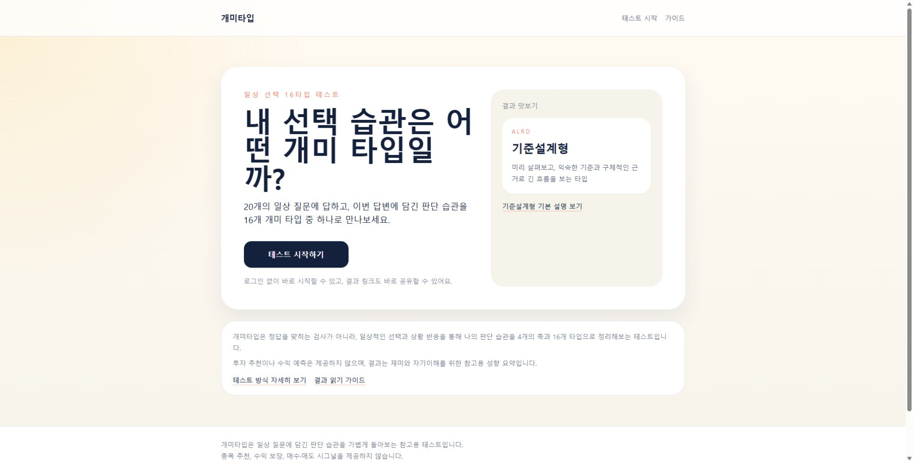
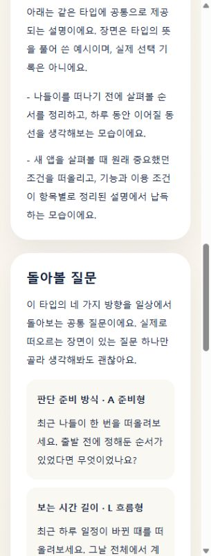
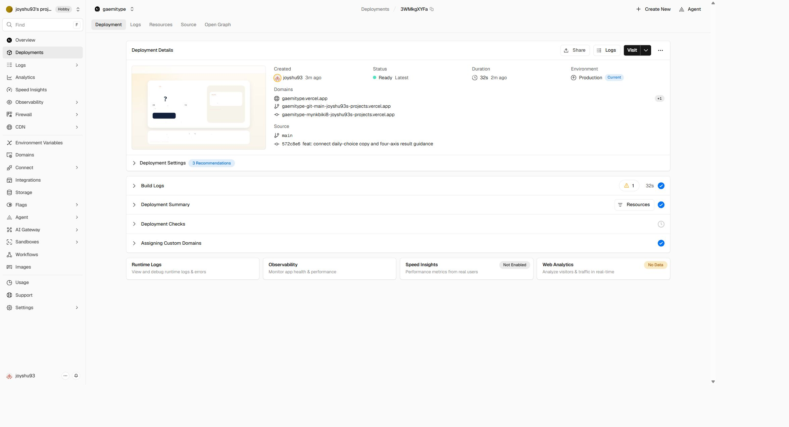

# C1–C3 운영 반영 및 공개 화면 검증

확인일: 2026-10-12 KST. 사용자가 **“운영 반영해줘”**라고 승인했다. **승인된 C1–C3를 운영에 반영하고 공개 화면의 핵심 동작을 확인했다.** 200% 브라우저 확대 미확인 사실을 고지한 뒤 받은 승인이다. 이를 확대 검증 통과로 해석하지 않는다. 광고 설정과 AdSense 재심사 제출은 실행하지 않았다.

## 배포와 범위

- 운영: [개미타입](https://gaemitype.vercel.app/)
- 제품 소스: `572c8e6e661ba5ecf60535dbcb67e30d490a7a70`
- 이전 운영 소스: `4321fe93ea35a0ffc31a839a310f2f8fd5c8aa38`
- [Vercel Production 배포](https://vercel.com/joyshu93s-projects/gaemitype/3WMkgXYFaeWvRE3ddHoawJYLUWvc): `3WMkgXYFaeWvRE3ddHoawJYLUWvc`
- 고유 배포 주소: `https://gaemitype-mynkbiki8-joyshu93s-projects.vercel.app`
- 메인이 Vercel 화면에서 환경 Production, 소스 main / 572c8e6, Ready, `gaemitype.vercel.app` 연결을 확인했다. 배포 화면에 표시된 시각은 2026-10-12 15:05:37 KST, 빌드 소요 표시는 32초였다.

배포 전 최신 원격 main이 이전 소스와 같은 것을 확인하고, 작업 트리의 제품 파일이 후보 커밋과 같으며 해당 커밋이 main의 후손임을 확인했다. 정확한 후보 SHA를 `refs/heads/main`에 일반 fast-forward push했다. 강제 push나 Preview 산출물 승격은 하지 않았다. 기존 Git 연동으로 Production 환경에서 새로 빌드했다.

| 승인 범위 | 운영 반영 내용 |
|---|---|
| C1 | 홈·소개·푸터·관련 메타를 일상 선택과 판단 습관 설명으로 변경 |
| C2 | 16타입 돌아볼 질문을 AP·LT·RI·DC 네 축별 공통 질문으로 표시 |
| C3 | 기존 결과 읽기 가이드에 가상 20개 답변·실제 집계 과정·3:2/5:0 대조·접힌 전체 원문·코드 전용 결과 링크 제공 |

질문 의미·순서·매핑·채점·타입명·공유 문구·이미지·광고 설정·환경변수는 이번 배포 라운드에서 바꾸지 않았다. 새 기능·라우트·의존성도 추가하지 않았다. [원고 승인안](2026-10-12-content-improvement-approval-plan.md)과 [구현·Preview 검증](2026-10-12-content-improvement-verification.md)에 상세 기준과 이전 검증을 보존했다.

## 이번 라운드의 새 검증 근거

| 구분 | 직접 실행 또는 관찰 결과 |
|---|---|
| 후보 자동 검사 | `npm.cmd test` 19개 통과, 실패 0 |
| 후보 린트 | `npm.cmd run lint` 종료 0 |
| 후보 운영 빌드 | `npm.cmd run build` 종료 0, 15개 정적 페이지 생성 |
| 배포 소스 | Preview에서 검증한 제품 SHA와 Production SHA가 동일 |
| 운영 홈·소개 | 새 제목·설명·비추천 안내를 실제 브라우저에서 확인 |
| 운영 가이드 | 가상 사례 고지가 발췌와 집계보다 앞에 표시. 네 축의 두 발췌, 3:2 표, 같은 타입 5:0 해설 확인 |
| 가이드 전체 원문 | 기본 닫힘, DOM에서 Q1–Q20 총 20개 확인. 320px에서 Enter 열기·Space 닫기·summary 포커스 확인 |
| 가이드→ALRC | 실제 링크 클릭으로 코드 전용 결과 진입. 가상 답변 전달 없이 타입 기본 설명과 네 공통 질문만 표시 |
| ALRD 개인 3:2 | `/result?code=ALRD&answers=01010010100101001010`: 네 축 각각 3/2 및 해당 선택 원문 2개 확인 |
| PTIC 개인 0:5 | `/result?code=PTIC&answers=11111111111111111111`: 네 축 각각 0/5 및 선택 원문 1개, P/T/I/C 질문 라벨 확인 |
| ALRD·ALRC 코드 전용 | 실제 개인 횟수·분포·선택 예시 없이 타입 방향과 네 질문 표시 |
| 잘못된 답변 | ALRD + 21자리 0: 개인 횟수·선택 사례가 없는 공유 표시 유지 |
| 운영 메타 | 가이드 canonical은 운영 가이드 주소. 결과 canonical·og:url은 운영 도메인 + code만 사용, og:image도 운영 도메인. answers·Preview 주소 없음 |
| 모바일 | 실제 브라우저 viewport 320×844 확인. 결과 네 질문·가이드 열린 상세에서 문서 가로 넘침 없음. 실제 휴대폰 검증과 구분 |
| 데스크톱 | 실제 기본 viewport 1920px에서 홈·소개·가이드·결과 확인. 결과 문서 너비 1905px로 가로 넘침 없음 |
| 광고 유지 | 확인한 운영 가이드·결과 DOM에서 광고 슬롯·adsbygoogle 스크립트 0개 |
| 브라우저 오류 | 검증한 운영 탭의 error 로그 0개 |

개인 결과 검증에는 메인이 만든 테스트 입력을 썼다. 이를 실제 사용자 조사 또는 실제 방문자 응답으로 표현하지 않는다. 가이드 자체의 가상 답변과 테스트 URL 입력도 별개다.

HTTP 요청으로 홈·소개·개인정보·가이드 목록·가이드 3종·robots·sitemap·ads.txt·Google 확인 파일·ALRD 이미지를 점검해 12개 모두 200 응답을 확인했다. robots의 Host/Sitemap과 sitemap 내 주소는 운영 도메인이었다. ads.txt는 기존 게시자 선언을 그대로 반환했다. 이 HTTP 검사는 화면 관찰과 구분한다.

## 역할별 판단과 메인 결정

| 역할 | 독립 검토 |
|---|---|
| PM | C1–C3 범위와 일치, 새 기능 확대 없음. 고지된 확대 미확인 한계 아래 받은 운영 승인을 적용 |
| Technical Architect | 제품 파일이 후보와 일치, Preview 전용 주소가 소스에 고정되지 않음. 정확한 SHA의 일반 push와 Production 재빌드 경로 채택 |
| QA | 개인 응답과 가상 사례 경계, 질문·축·채점·공유 불변 확인. 제품 차단 결함 발견 없음. 운영 도메인·결과 분기·모바일 재확인 요청 |

역할 간 배포 판단 충돌은 없었다. 이전 문서의 “확대 배포 전 필수 / 운영 미승인”과 이후 사용자 승인의 시점 차이가 있었다. 메인은 제품 핵심 원칙 → MVP 범위 → 구현 복잡도 순서로 판단하여, 확대를 통과로 표시하지 않고 잔여 한계를 보존한 채 승인된 동일 제품만 배포했다. 역할 검토는 실제 운영 화면 검증을 대신하지 않았고 메인이 위 항목을 직접 확인했다.

## QA: 오해 가능성

- 가이드 가상 사례를 자신의 응답이나 실제 사용자 연구로 받아들이는 것: 가상 고지, 전체 원문과 코드 전용 링크로 구분한다.
- 네 공통 질문을 자신의 답변에서 뽑은 사례로 받아들이는 것: 공통 질문 안내와 실제 선택 예시 영역을 구분한다.
- 배포 완료를 AdSense 승인 또는 반려 원인 해결 확정으로 받아들이는 것: 콘텐츠 반영 사실과 Google의 심사 판단을 구분한다.

## QA: 금지 표현

선택 횟수를 성격 강도·검사 정확도·투자 능력으로 단정하는 표현, 종목/포트폴리오 추천·수익/위험 회피 보장·매수/매도 신호, “모든 수동 QA 완료”, “200% 확대 확인 완료”, “AdSense 승인 보장”을 사용하지 않는다.

## QA: 남은 수동 검증과 한계

- **200% 실제 브라우저 확대:** 미확인. 이전 도구의 설정 화면 접근이 보안 정책으로 거절됐고 우회하지 않았다. 이 사실을 고지받은 사용자가 운영 반영을 승인했다.
- 실제 휴대폰, 화면 읽기 도구, 메신저별 외부 OG 캐시는 이번 라운드에서 새로 확인하지 않았다.
- 질문 20개 전체 완주는 직전 로컬 검증 기록에 있으며, 이번 운영 라운드에서 다시 완주했다고 주장하지 않는다.
- Google이 어느 페이지·버전을 검토했는지, 실제 사용자 관심·유지율, 이번 변경이 심사에 미칠 효과는 확인하지 않았다.

## 파일 보존과 후속 작업 기준

실제 루트는 `C:\Users\D-\Documents\Codex_Project\GaemigulTest`다. 사용자 미커밋 README·이전 운영 기록·미추적 보고서를 삭제·reset·stash하지 않았다. 원래 반려 보고서 SHA256 `6D82C915406BF1E94BD1EC8647224C6B130C66B0E605B383FDBE8D1196A3C833`도 유지됐다.

**원격 main과 운영은 572c8e6, 루트의 로컬 main은 4321fe9다.** 기존 변경이 있는 루트에 즉시 pull/merge하지 않았다. 최신 제품 소스는 `.worktrees/approved-experience`에 있으며 해당 브랜치와 작업 트리를 보존했다. 후속 구현은 이 차이를 먼저 확인해야 한다. 이번 README·승인/검증 상태 갱신과 운영 증거는 루트 및 작업 트리에 로컬 문서로 저장했으며 추가 커밋·푸시하지 않았다.

README는 운영 반영 상태, 배포 기록 링크, 미확인 항목, 로컬과 원격 main의 차이를 갱신했다. 실행 방법·환경변수·배포 방법 자체는 유지했다.

| 구분 | 상태 |
|---|---|
| 완료 | 승인 C1–C3 운영 반영, 소스·Ready·도메인·공개 화면·메타·HTTP 확인, 기록 저장 |
| 부분 완료 | 환경별 수동 QA: 확대·실기기·외부 메신저 등 위 한계 |
| 미완 | 후속 AdSense 재심사 제출과 심사 결과 |
| 배포 전 필수 | 이번 후보의 자동 검사·역할 검토·명시적 운영 승인 완료 |
| 출시 후 과제 | 사용자가 운영 수정본을 기준으로 재심사 요청, 실제 결과에 따른 판단 |

다음 단계는 AdSense의 해당 사이트에서 수정 사항 확인 후 검토 요청이다. 이 문서는 계정의 새 제출 완료를 의미하지 않는다. 새 기능·글 수·글자 수·방문자 수를 재심사 승인 조건으로 추가하지 않는다.

## 화면 증거

